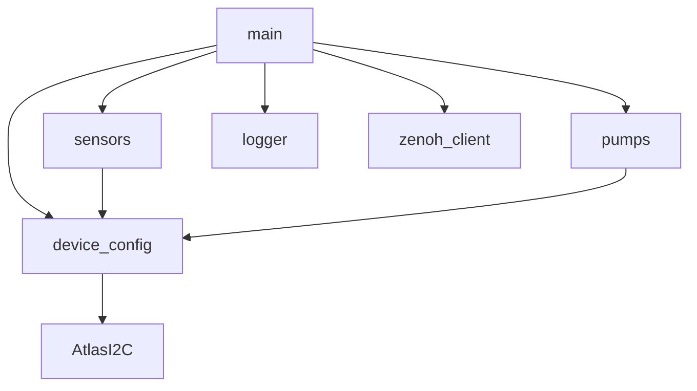
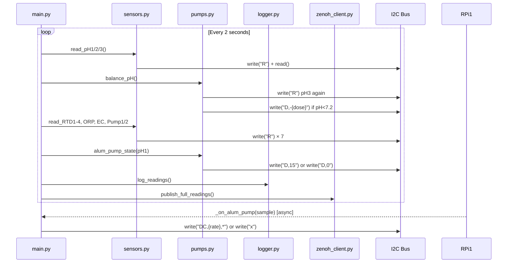

# Architecture — RENO-RPI2

## High-Level Architecture

The system is a **two-node IoT pipeline**. RPi1 is the upstream gateway (Zenoh router, MQTT bridge, dashboard) and RPi2 is this node — the sensor/actuator embedded controller.

```
┌─────────────────────────────────────────────────────────────────┐
│                    Physical Water Treatment Plant               │
│                                                                 │
│  ┌──────────────┐        ┌──────────────────────────────────┐  │
│  │    RPi1      │        │             RPi2                 │  │
│  │ (Gateway)    │◄──────►│    (Sensor / Actuator Node)      │  │
│  │ Zenoh Router │ Zenoh  │                                  │  │
│  │ MQTT Bridge  │TCP/VPN │  main.py  (2-second loop)        │  │
│  │ Dashboard    │        │     │                            │  │
│  └──────────────┘        │     ├── sensors.py               │  │
│                           │     ├── pumps.py                 │  │
│                           │     ├── logger.py → CSV          │  │
│                           │     └── zenoh_client.py          │  │
│                           │              │                   │  │
│                           │         /dev/i2c-1               │  │
│                           │              │                   │  │
│                           │  ┌───────────┴────────────────┐ │  │
│                           │  │   Atlas Scientific EZO Bus  │ │  │
│                           │  │  pH1 pH2 pH3 ORP EC RTD×4  │ │  │
│                           │  │  Pump1(Alum)  Pump2(Lime)  │ │  │
│                           │  └─────────────────────────────┘ │  │
│                           └──────────────────────────────────┘  │
└─────────────────────────────────────────────────────────────────┘
```

---

## Execution Flow (Ponytail Method)

### Startup

```
python3 main.py
  └─► import device_config
        └─► _init_device(99..110) × 9 devices
              └─► AtlasI2C() — opens /dev/i2c-1
              └─► dev.query("I")    → module type
              └─► dev.query("name,?") → device name
  └─► import zenoh_client (module-level)
        └─► zenoh.open(conf) — connects TCP to RPI1_ROUTER
  └─► run()
        └─► new_log_file() → creates timestamped CSV with headers
        └─► subscribe_alum_pump(_on_alum_pump)
              └─► zenoh session.declare_subscriber("reno/water/alum/pump", cb)
```

### Per-Iteration Loop (every 2 seconds)

```
while True:
  ├─ read_pH1()  → device_pH1.write("R") + sleep(1.5) + device_pH1.read()
  ├─ read_pH2()  → same pattern
  ├─ read_pH3()  → same pattern
  │
  ├─ balance_pH()
  │    ├─ device_pH3.write("R") + sleep(1.5) + device_pH3.read()   ← pH3 read again!
  │    └─ if pH3 < 7.2: device_Pump2.write(f"D,-{dose}")
  │
  ├─ read_RTD1..4(), read_ORP(), read_EC()
  ├─ read_Pump1(), read_Pump2()
  │
  ├─ alum_pump_state(pH1)          ← SIDE EFFECT: writes D,15 or D,0 to Pump1
  │
  ├─ log_readings(log_file, readings)   → appends one CSV row
  │
  ├─ publish_full_readings(readings)    → zenoh.put(KEY_EXPR, json)
  │
  └─ time.sleep(2)
```

### Asynchronous Alum Pump Callback

```
[RPi1 publishes "reno/water/alum/pump"]
  └─► _on_alum_pump(sample)
        ├─ if ml_per_min >= 0.5: device_Pump1.write(f"DC,{ml_per_min},*")
        └─ else: device_Pump1.write("x")
```

> This callback fires on the Zenoh background thread and **can race** with `alum_pump_state()` in the main loop. See `TODO.md`.

---

## Folder Organization

All files live in a single flat directory — no sub-packages. Dependency order:

```
AtlasI2C.py          ← no project imports (hardware driver)
    ▲
device_config.py     ← imports AtlasI2C; creates all device singletons
    ▲
sensors.py           ← imports device singletons; pure read wrappers
pumps.py             ← imports device singletons; control + logic
logger.py            ← no project imports; CSV utilities
zenoh_client.py      ← no project imports; networking
    ▲
main.py              ← imports everything; orchestration
```

---

## Component Responsibilities

| Module | Responsibility |
|---|---|
| `main.py` | Orchestration — loop timing, data assembly, wiring callbacks |
| `device_config.py` | One-time I2C device initialization; exports singleton objects |
| `AtlasI2C.py` | Low-level I2C byte protocol for Atlas EZO chips |
| `sensors.py` | Named read functions — thin wrappers with labelled print output |
| `pumps.py` | Chemical dosing logic — lime dose curve, alum state, emergency stop |
| `zenoh_client.py` | Zenoh session lifecycle, key expressions, publish + subscribe |
| `logger.py` | CSV file creation and row appending |

---

## Design Patterns

- **Singleton devices** — all hardware objects are module-level globals in `device_config.py`, imported by name everywhere. No dependency injection.
- **Polling loop** — a blocking `while True` loop drives all sensing; no async/await or threads in the main path.
- **Fail-soft networking** — if Zenoh fails to connect at startup, `_session` is `None` and publish/subscribe calls silently no-op.
- **Flat namespace** — no classes, no services pattern; pure procedural Python with functions.

---

## Water Treatment Process Stages

```
Raw Water In
    │
    ▼
[Pre Rapid Mix]
    pH1  (addr 99)   ORP (addr 98)
    RTD1 (addr 102)  RTD2 (addr 104)
    │
    ▼  ← Alum dosing (Pump1, addr 109)
[Flocculation]
    pH2  (addr 96)
    RTD3 (addr 105)
    │
    ▼
[Sedimentation]
    pH3  (addr 97)  ← triggers Lime dose decision
    │
    ▼  ← Lime dosing (Pump2, addr 110)
[Post Lime]
    EC   (addr 100)
    │
    ▼
[Effluent]
    RTD4 (addr 106)
```

---

## Zenoh Communication

```
RPi2 → "reno/water/treatment/010"   (publishes JSON with all readings)
RPi1 → "reno/water/alum/pump"       (publishes {"ml_per_min": float})
```

RPi1 acts as the Zenoh router (`zenohd`); RPi2 connects as a client over Tailscale VPN address `100.96.169.94:7447`.

---

## Request / Data Lifecycle

```
I2C hardware reading
  │ 31 bytes
  ▼
AtlasI2C.read()
  │ parses "Success <device>: <value>"
  ▼
sensors._read()
  │ extracts value after ": ", strips null bytes
  ▼
main.run() loop
  │ assembles readings dict
  ├──► logger.log_readings()  → CSV row appended
  └──► zenoh_client.publish_full_readings()  → JSON over TCP to RPi1
```

---

## Mermaid Diagrams

### Module Dependency Graph



### Main Loop Sequence


